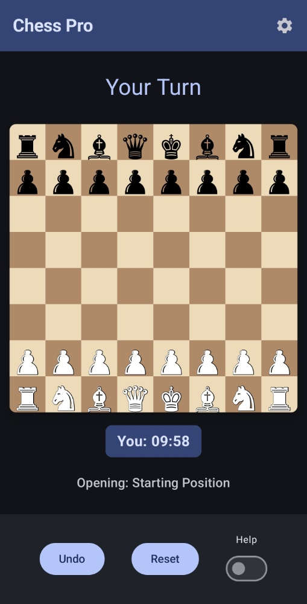

# Android Chess Game AI

**Android Chess Game AI** is a high-performance, native Android chess application built with **Kotlin** and **Jetpack Compose**. Since v0.8 it is powered by **Stockfish 19**, the strongest open-source chess engine in the world, offering a fluid and challenging experience for players of all levels.

---

## 🆕 What's new in v0.8 — the Stockfish upgrade

* **New algorithm: Stockfish 19 replaces the previous custom-built engine as the primary brain.** The old engine had a root-search flaw that could make it misevaluate candidate moves — at Medium it sometimes skipped a free capture or left a piece hanging. v0.8 embeds the official Stockfish 19 binary (ARM64) and drives it over UCI: positions are translated to FEN under this app's exact ruleset (castling supported, no en passant), and every Stockfish reply is validated against the app's own legal-move generator before being played. Difficulty is now Stockfish's own Skill Level (Easy 5 · Medium 11 · Hard 17 · Expert 20). The built-in engine is still there as an automatic fallback — with the root-search flaw fixed — in case the Stockfish process can't run.
* **King of the Hill variant** (new toggle): win by checkmate or by moving your king onto d4, e4, d5 or e5. Pick the AI's stance, **Offensive** or **Defensive**. Stockfish doesn't natively know this variant, so a variant layer around the engine enforces it.
* **"Force AI to capture when possible"** toggle (renamed in v0.7) keeps working under Stockfish via UCI `searchmoves`.

---

## 🚀 Key Features

* **Stockfish 19 Engine**: Since v0.8 the opponent is the real **Stockfish 19** (bundled binary, UCI), with four difficulty levels mapped to Stockfish Skill Levels: Easy 5, Medium 11, Hard 17, Expert 20. The built-in Kotlin engine remains as an automatic fallback. See `STOCKFISH.md` for details and licensing.
* **Force AI to capture when possible**: Optional rule (Settings, off by default) that forces the AI to capture whenever a capture is available — "always eat when it can".
* **King of the Hill variant**: Optional variant (New Game, off by default): win by checkmate OR by legally moving your king onto one of the four central squares (d4, e4, d5, e5). Choose the AI's approach — **Offensive** (it races its own king to the hill) or **Defensive** (it prioritises keeping your king away). Either way, the AI takes a hill win the moment one exists and never allows you an immediate hill win when it can be prevented. Official Stockfish doesn't know this variant, so `StockfishEngine.kt` enforces it around the engine (legal-move pool filtering + stance tie-breaking over Stockfish's MultiPV ranking); the built-in fallback engine has the same rules baked into its search.
* **Real-Time Opening Recognition**: Automatically identifies and displays classic chess openings as you play, such as the **London System**, **Sicilian Defense**, and **Ruy Lopez**.
* **Advanced Time Control**: Customizable player timers ranging from 3-minute blitz to 30-minute classical sessions.
* **Dynamic Help Mode**: Real-time visual indicators highlighting legal moves and identifying dangerous squares under immediate threat.
* **Strategic AI Openings**: Configure the AI to start with specific opening strategies to practice against particular lines.
* **Undo System**: Integrated move-rollback capability with a persistent counter to track your progress.
* **Tournament Standards**: Full support for complex rules including castling, pawn promotion (Queen, Rook, Bishop, Knight), and stalemate detection.

## 📸 Screenshots

<table style="width:100%">
  <tr>
    <th style="text-align:center">Gameplay</th>
  </tr>
  <tr>
    <td></td>
  </tr>
</table>

---

## 🧠 AI Logic & Algorithm

The "brain" of Android Chess Game AI is **Stockfish 19**, the strongest open-source chess engine in the world, bundled as a native ARM64 binary and driven over the UCI protocol by `StockfishEngine.kt`.

### How Stockfish is integrated
* **Position translation**: the app's board is converted to FEN under this app's exact ruleset — castling rights are derived from each piece's moved state, and the en passant field is always `-` because this app's rules don't include en passant.
* **Move validation**: every move Stockfish returns is checked against the app's own legal-move generator before it is played, so the app's rules are always the source of truth.
* **Process model**: Stockfish runs as a separate process (it ships as `libstockfish.so` in `jniLibs`, the standard way to get an executable binary onto Android) and thinks on a background thread, so the board never freezes.
* **Fallback**: a lightweight built-in engine remains in the app and takes over automatically if the Stockfish process can't start — you'll never be left without an opponent.

### Difficulty levels
Difficulty is Stockfish's own **Skill Level** setting, with per-level thinking-time budgets:

| Level | Stockfish Skill | Thinking time |
|-------|----------------|---------------|
| Easy | 5 | ~0.3 s |
| Medium | 11 | ~0.6 s |
| Hard | 17 | ~1.2 s |
| Expert | 20 (full strength) | ~2.5 s |

### King of the Hill support
Official Stockfish only plays standard chess, so the King of the Hill variant is enforced by a layer around the engine (`StockfishEngine.kt`): an immediate hill win is played at once, any move that would hand the player an immediate hill win is filtered out of Stockfish's candidate pool, and the chosen **Offensive/Defensive** stance breaks ties in Stockfish's MultiPV ranking — Offensive favouring the move that brings the AI's king closest to the hill, Defensive the move that leaves the player's king farthest from it.

### Force capture
With **"Force AI to capture when possible"** enabled, Stockfish is restricted via UCI `searchmoves` to the app's legal captures, so the rule holds exactly.

---

## 🛠️ Compilation & Deployment

### Local Environment (Ubuntu/Debian)
Ensure you have **Java 17** installed.
```bash
git clone [https://github.com/assix/Android-Chess-Game-AI.git](https://github.com/assix/Android-Chess-Game-AI.git)
cd Android-Chess-Game-AI
chmod +x gradlew
./gradlew assembleDebug
```
The compiled APK will be located at `app/build/outputs/apk/debug/app-debug.apk`.

### Google Colab (Cloud Build)
If you are away from your primary machine, you can compile the APK in the cloud:
1.  Open a new Colab notebook.
2.  Install OpenJDK 17 and set `JAVA_HOME`.
3.  Clone the repository, grant permissions to `gradlew`, and run `./gradlew assembleDebug`.
4.  Download the resulting file from `app/build/outputs/apk/debug/app-debug.apk`.

---
Developed by assix.
